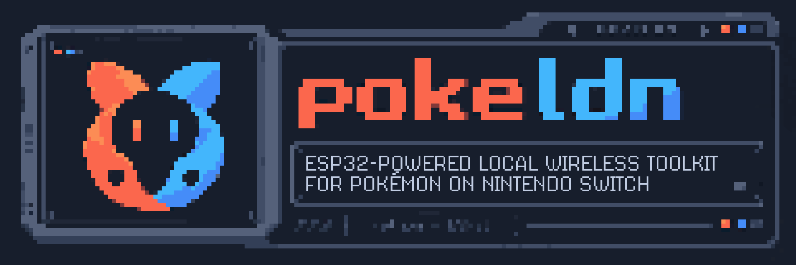
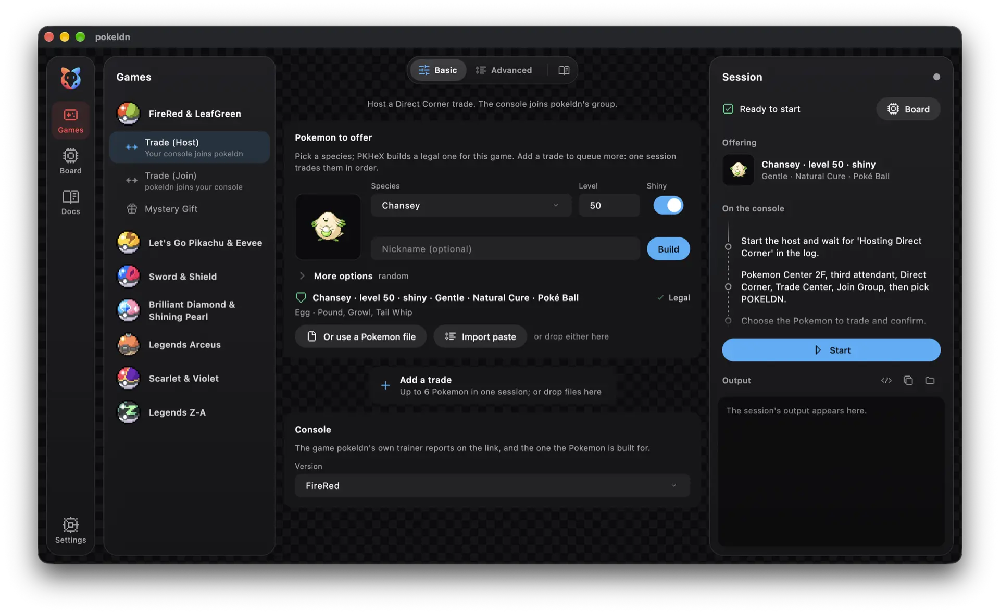

  

  
  
  
  

# pokeldn

Trade with retail Pokémon games on Switch and Switch 2 through an ESP32 board connected to your
computer by USB. Nothing is installed on the console.

The desktop app runs on macOS (Apple silicon), Windows and Linux. The same app runs on Android, with
the board on the phone's USB port, and on iPhone and iPad, with the board reached over Bluetooth.
Command-line tools run from source.
The project also documents the games' local wireless protocols. AI tools helped reverse engineer
those protocols and write parts of the code.

## Supported games

| | [FRLG](docs/frlg.md) | [LGPE](docs/lgpe.md) | [SwSh](docs/swsh.md) | [BDSP](docs/bdsp.md) | [PLA](docs/pla.md) | [SV](docs/sv.md) | [PLZA](docs/za.md) |
|---|:---:|:---:|:---:|:---:|:---:|:---:|:---:|
| Trade | ✓ | ✓ | ✓ | ✓ | ✓ | ✓ | ✓ |
| Online trade | ✓ | ○ | ○ | ○ | ○ | ✓ | ○ |
| Mystery Gift | ✓ | ∅ | ✓ | ∅ | ∅ | ∅ | ∅ |
| Event Pokemon | ✓ | ✓ | ✓ | ✓ | ✓ | ✓ | ✓ |
| Link battle | ✓ | ✗ | ✗ | ✗ | ∅ | ✗ | ✗ |
| Console code and save read/write | ✓ | ✗ | ✗ | ✗ | ✗ | ✗ | ✗ |

✓ verified on retail hardware · ○ tested offline only · ✗ not implemented · ∅ unavailable over local wireless

FRLG: FireRed/LeafGreen · LGPE: Let's Go Pikachu/Eevee · SwSh: Sword/Shield ·
BDSP: Brilliant Diamond/Shining Pearl · PLA: Legends Arceus · SV: Scarlet/Violet · PLZA: Legends Z-A

Scarlet/Violet also supports [local Tera Raids](docs/sv_raid.md) and the
[Union Circle](docs/sv_union_circle.md) as a guest, and Sword/Shield
[Max Raid Battles and Dynamax Adventures](docs/swsh_raid.md) with a chosen boss or legendary. Event Pokemon arrive through Mystery
Gift on FRLG and SwSh, and on the other titles as a fresh legal copy of an official gift traded by the
game's trade host ([Simulated Mystery Gifts](docs/gift_simulated.md)).
See each game's docs for setup, features and verification coverage.

## Get started

You need a [supported ESP32 board](docs/hardware_esp32.md#supported-boards), a USB data cable,
Switch `prod.keys`, and a Switch or Switch 2 with a supported game.

1. Download the app from [Releases](https://github.com/Decryptu/pokeldn/releases) or [pokeldn.app](https://pokeldn.app).
2. Choose `prod.keys` in Settings.
3. Connect the board and install the Wireless firmware from the Board page.
4. Choose a game and tool, then follow the console instructions in the app.

On a phone:

- **Android**: install `pokeldn-android-arm64.apk` from Releases and plug an ESP32-S3, C3 or C6, or a
  classic ESP32 with a CP210x USB chip, into the phone with a USB data cable
  ([Android setup](docs/gui.md#android-setup-requirements)).
- **iPhone and iPad**: install `pokeldn-ios.ipa` with AltStore or SideStore (the app's
  [AltStore source](https://raw.githubusercontent.com/Decryptu/pokeldn/main/.github/altstore/source.json)).
  Flash the board once with the **Bluetooth wireless** firmware from the desktop app's Board page; it
  then needs USB only for power ([iOS setup](docs/gui.md#ios-setup)).

See [app setup](docs/gui.md), [first launch](docs/gui.md#first-launch),
[Windows USB drivers](docs/gui.md#windows-usb-drivers) and [Linux serial ports](docs/gui.md#linux-serial-ports).

## Documentation

| Topic | Guide |
|---|---|
| Command-line setup and game commands | [Usage](docs/usage.md) |
| Bank, Pokémon imports and conversion | [Bank](docs/gui.md#the-bank) |
| Online trades and GTS | [Online trade](docs/online.md), [GTS](docs/online.md#the-gts) |
| Building and sharing Mystery Gifts | [Gift files](docs/gifts.md) |
| FireRed/LeafGreen save backups and restores | [Save backup and restore](docs/frlg_gift.md#save-backup-and-restore) |
| Controller and macros | [Controller](docs/gui.md#the-controller) |
| Installing or writing plugins | [Plugins](docs/plugins.md) |
| Windows USB Wi-Fi adapters | [ldnrs setup](docs/hardware_adapters.md#windows-usb-wi-fi-through-ldnrs) |
| Boards, firmware and optional screens | [ESP32 radio](docs/hardware_esp32.md) |
| Running and building the desktop app from source | [Desktop builds](docs/gui.md#run-from-source) |
| Building the Android app | [Android app](examples/android/README.md) |
| Building the iOS app (Bluetooth radio, AltStore) | [iOS app](examples/ios/README.md) |
| Code layout, Pokémon legality and tests | [Code organization](docs/architecture.md) |
| Wireless protocols and reverse engineering | [Documentation index](docs/index.md) |

The docs are also published at [decryptu.github.io/pokeldn](https://decryptu.github.io/pokeldn/).

## Credits

pokeldn is a fork of [MercuryEnigma/frlg-ldn-trade](https://github.com/MercuryEnigma/frlg-ldn-trade)
by [MercuryEnigma](https://github.com/MercuryEnigma), itself a fork of
[tornadus/frlg-ldn-trade](https://github.com/tornadus/frlg-ldn-trade) by
[tornadus](https://github.com/tornadus), with contributions from
[trowgundam](https://github.com/trowgundam).

Contributors to this repository (GitHub does not list contributors on a fork):

- [Gr3nSkyDragon](https://github.com/Gr3nSkyDragon): ESP32-S3 firmware
- [ismailhasannnnnn](https://github.com/ismailhasannnnnn): Scarlet/Violet Tera Raid hosting and joining,
  reverse engineering and reconstruction of the RaidPoint structure, including reward encoding and
  raid bootstrap compression, and hosted raid reward templates
- [easyworld](https://github.com/easyworld): ESP32 serial reconnects after a high-baud session, and
  language packs that translate game names, module messages, tool help, the documentation and its
  page titles, game choices and raid partners' names
- [capito27](https://github.com/capito27): Scarlet/Violet event Tera Raids, the raid finder's reward
  filter, its full seed search, its ranking by rewards and its size mark filter, and the Tera Raid
  NPC partners: their draw from the RaidPoint and the host's choice of them; Simulated Mystery Gifts
  made for the receiving save, pop-ups for programs, Pokemon HOME's gifts among Sword/Shield's
  official events, a Tera Raid boss's scripted actions, Legends Arceus's trainer gender, the
  ESP32 credit for a frame still being written, near doubling USB upload speed, and the
  Scarlet/Violet Union Circle guest: Blueberry Quest clears, Snacksworth's legendaries and
  crafted wild encounters
- [DedHapp3n](https://github.com/DedHapp3n): classic ESP32 boards with a CP210x USB chip in the Android
  app
- [elsardine6k7](https://github.com/elsardine6k7): friendship in the Pokemon builder, Showdown sets and
  the Simulated Mystery Gift queue
- [junkmailkeep](https://github.com/junkmailkeep): Mystery Gift sprites and form previews in the gift
  and trade editors
- [MarcJa420](https://github.com/MarcJa420): the E32R40T 4-inch screen build, the firmware version on
  the idle screen, hosted raid and Dynamax Adventure lobbies on the board's screen, and Gigantamax
  sprites

- [unlimitedcoder2](https://github.com/unlimitedcoder2): [ldnrs](https://github.com/unlimitedcoder2/ldnrs),
  the external Windows USB Wi-Fi daemon supported by the optional radio backend
- [kinnay](https://github.com/kinnay): the [LDN library](https://github.com/kinnay/LDN) this builds on,
  and the [NintendoClients wiki](https://github.com/kinnay/NintendoClients/wiki)
- [pokefirered](https://github.com/pret/pokefirered): decompilation of FireRed/LeafGreen, including
  the Switch port
- [GB-Link Team](https://github.com/GB-Link/GB-Link-Switch-LDN): the custom FireRed/LeafGreen Wonder
  Cards in `vendor/gblink-cards/` (GPL-3.0)
- [xCyrusBR](https://github.com/xCyrusBR): [TeraLoop-Bridge](https://github.com/xCyrusBR/TeraLoop-Bridge),
  [SV-Past-Tera-Raid](https://github.com/xCyrusBR/SV-Past-Tera-Raid) and
  [pokeldn-TeraLoop-](https://github.com/xCyrusBR/pokeldn-TeraLoop-), Scarlet/Violet Tera Raid
  work, including the raid host waiting for the console's Ready
- [Project Pokemon](https://github.com/projectpokemon): the [EventsGallery](https://github.com/projectpokemon/EventsGallery)
  of Scarlet/Violet raid event deliveries the app downloads, with pkNX's text of each
- [Matcore962](https://github.com/Matcore962): importing Pokemon files and game saves into the Bank

## Code signing policy

Free code signing provided by [SignPath.io](https://about.signpath.io), certificate by [SignPath Foundation](https://signpath.org).
What is signed, the team roles and the privacy policy are on the
[Code signing policy](https://decryptu.github.io/pokeldn/code_signing.html) page.

## License

The code is licensed under AGPLv3. The license covers this repository's code and nothing else.

pokeldn is an unofficial fan project. It is not affiliated with, endorsed by or sponsored by
Nintendo, The Pokemon Company, Game Freak or Creatures. Pokemon, Nintendo Switch and the related
names and characters are trademarks of their owners. Under section 7(e) of the AGPL, no right to
use those trademarks or any other Pokemon intellectual property is granted.

The authors do not endorse using pokeldn for commercial, promotional or branded events, including
Mystery Gift distributions. Anyone who does so is responsible for obtaining the rights it requires.
